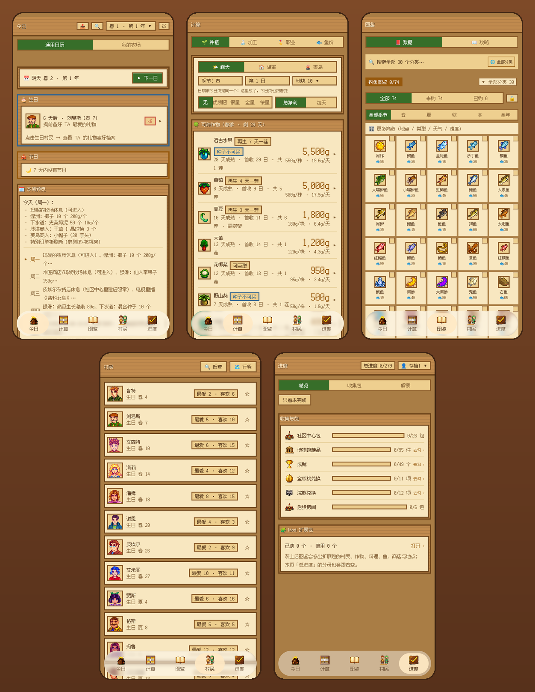

<div align="center">


# 星露小助手 · Stardew Helper

**完全离线的《星露谷物语》攻略助手**

今日待办 · 图鉴 · 送礼反查 · 收益计算 · 存档解析

[](https://github.com/huututu939/xingluguzhushou/releases/latest)
[](#下载与安装)
[](#项目结构)
[](LICENSING.md)
[](https://github.com/huututu939/StardewHelper/actions/workflows/ci.yml)

<a href="https://github.com/huututu939/xingluguzhushou/releases/latest">
  
</a>

[更新日志](CHANGELOG.md) · [问题反馈](https://github.com/huututu939/StardewHelper/issues) · [参与贡献](CONTRIBUTING.md) · [许可范围](LICENSING.md)

</div>

---

> ⚠️ **非官方粉丝工具**。与 ConcernedApe（星露谷物语作者）无关联、未获其背书。
> 游戏素材、名称与商标归 ConcernedApe 所有。

## 这是什么

把游戏里查不到的东西 —— 今天该干什么、材料去哪找、这东西该送给谁、种什么最赚 ——
做成一个**不用联网、不申请多余权限**的 Android App。导入存档只读不改，
所有数据都打包在安装包里。

## 功能

| | | |
|---|---|---|
| 📅 **今日**<br>节日、生日、商店营业时间、播种死线、今日待办 | 🧮 **计算**<br>种植收益、加工利润、职业技能经验、鱼价 | 📕 **图鉴**<br>作物 / 菜谱 / 鱼 / 怪物 / 商店 / 矿物，外加攻略册 |
| 👥 **村民**<br>礼物喜好、生日、行程、心事件，可反查「该送给谁」 | 📈 **进度**<br>收集包、博物馆、成就、金核桃 | 🧩 **更多**<br>存档解析、农场年报长图、桌面小组件、局域网传存档 |

## 预览

<div align="center">



</div>

## 下载与安装

| 最新版本 | 大小 | 要求 |
|---|---|---|
| [v2.152.1](https://github.com/huututu939/xingluguzhushou/releases/latest) | 4.1 MB | Android 8.0+（minSdk 26） |

1. 点上面的按钮，下载 `stardew-assistant_v*.apk`
2. 手机上允许「安装未知来源应用」
3. 覆盖安装即可，存档与勾选记录都不会丢

> App 内「设置 → 在线更新」可以检查新版本；不想联网，同一处可以关掉。

## 项目结构

```text
StardewHelper/                Android 主工程（Kotlin + Jetpack Compose）
  app/src/main/assets/data/   整理后的游戏数据（CC BY-NC-SA 3.0）
  app/src/main/assets/img/    游戏图标与界面素材
StardewAutoPush/              电脑端 SMAPI 模组（.NET 6）
```

> **分工**：源码与模组在本仓库；APK、Mod 扩展包、`send_save.bat` 等发布产物放在
> [`huututu939/xingluguzhushou`](https://github.com/huututu939/xingluguzhushou) 的 Release，
> App 内的更新检查与 Mod 下载从那里拉取。
> 只有 Android App 这一套源码，**不含** Web 版与小程序的源码。

## 常见问题

<details>
<summary><b>需要联网吗？</b></summary>

攻略、图鉴、计算全部离线可用。联网只有两处，都可以不用：
打开 App 时静默检查一次更新（可在设置里关掉）、以及你手动点的「检查更新」/「Mod 扩展」下载。

</details>

<details>
<summary><b>会改我的存档吗？</b></summary>

不会。存档解析是**只读**的：选文件（zip）或从电脑接收后，只在本机读取并解析。
「从电脑接收」只连同一个 WiFi，不经过任何服务器，也不会往外发数据。

</details>

<details>
<summary><b>检查更新失败 / 转圈很久？</b></summary>

更新走 GitHub Release。部分网络环境下 GitHub 域名不稳定，可以稍后重试，
或直接从 [Release 页](https://github.com/huututu939/xingluguzhushou/releases/latest) 手动下载覆盖安装。

</details>

<details>
<summary><b>卸载会丢进度吗？</b></summary>

会。勾选记录、导入的存档解析结果都存在 App 私有目录，卸载会一起删除。
换机前请先用「设置 → 💾 进度备份」导出 JSON。

</details>

## 从源码构建

<details>
<summary><b>Android 工程</b>（需要 JDK 17 / Android SDK 35）</summary>

```bash
# 1. 告诉 Gradle 你的 SDK 在哪（这个文件不要提交，各人机器路径不同）
echo "sdk.dir=/path/to/android-sdk" > local.properties

# 2. 构建（Windows 用 gradlew.bat）
cd StardewHelper
./gradlew assembleDebug        # 产物在 app/build/outputs/apk/debug/
```

Windows 下：

```bat
cd StardewHelper
gradlew.bat assembleDebug
```

> `gradle-wrapper.properties` 里用的是腾讯云镜像下载 Gradle，国内拉取快些；
> 换官方源删掉 `distributionUrl` 里的 `mirrors.cloud.tencent.com` 即可。

**签名**：仓库里的构建脚本用 **debug 签名**（见 `app/build.gradle.kts`）。
要发自己的包，请在 `signingConfigs` 里配自己的 keystore —— **别把 keystore
提交上来**，`.gitignore` 已经挡了 `*.jks` / `*.keystore`。

</details>

<details>
<summary><b>电脑端模组</b>（需要 .NET 6 与 SMAPI）</summary>

`StardewAutoPush/` 依赖 SMAPI 的 `Pathoschild.Stardew.ModBuildConfig`：

```bash
cd StardewAutoPush
dotnet build -c Release
```

构建完成后，把 `bin/Release/net6.0/StardewAutoPush/` 整个文件夹放进游戏目录的
`Mods/` 下（需要先装 [SMAPI](https://smapi.io/)，游戏 1.6 / SMAPI 4.x）。

</details>

## 电脑端：把存档推到手机

两条路，任选其一：

- **装模组（推荐）**：装 `StardewAutoPush/`，游戏里一保存就自动把存档推到手机。
  需要先装 [SMAPI](https://smapi.io/)。
- **手动脚本**：电脑上双击 `send_save.bat`，手动推一次。

两条路都只在**你的局域网内**传输，存档**只读不改**，不经任何服务器。

## 数据从哪来

`assets/data/` 下的内容整理自 **Stardew Valley Wiki**
（[英文站](https://stardewvalleywiki.com/) /
[官方简中站](https://zh.stardewvalleywiki.com/)），适用
**CC BY-NC-SA 3.0**（署名 + 非商业 + 同协议共享）。
协议全文在 `app/src/main/res/raw/cc_by_nc_sa_3_0.txt`（随 APK 内置），
数据说明见 `assets/data/README.md`。

带「未核」标记的字段表示 wiki 缺页、尚未核对，**不要当成事实引用**。

## 许可

| 范围 | 协议 |
|---|---|
| 应用源码 / 构建脚本 / 电脑端模组 / 推送脚本 | **MIT**（根 [`LICENSE`](LICENSE)） |
| `app/src/main/assets/data/` 整理数据 | **CC BY-NC-SA 3.0**（署名 + 非商业 + 同协议共享） |
| `app/src/main/assets/img/` 游戏素材 | 归 **ConcernedApe**，不随本仓库授权 |
| 字体子集 TutuPixel | SIL OFL 1.1（上游 Fusion Pixel Font / TakWolf） |
| 底栏玻璃算法 AndroidLiquidGlass | Apache-2.0 |

**分层协议的完整说明见 [`LICENSING.md`](LICENSING.md)** —— 尤其注意数据部分
「非商业」那一条：自己 fork、修改、自己用没问题，拿它收费或换钱就越界了。

## 状态

项目**更新频率已放缓**。源码公开，欢迎自行 fork、修改、二次分发。
发现问题欢迎提 [Issue](https://github.com/huututu939/StardewHelper/issues)，或者直接改。
